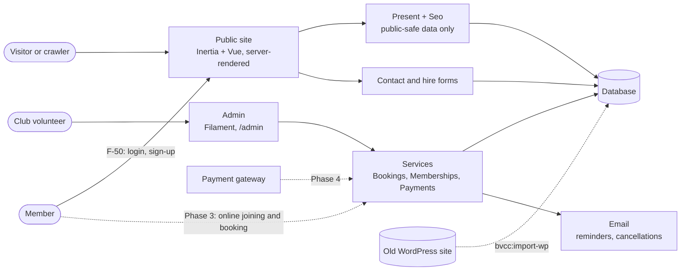

# BVCC docs

Planning and specs for the site, written in Markdown and kept next to the
code. Nothing in this folder is served by the app.

| Doc                      | What it's for                                                                                                                                                     |
| ------------------------ | ----------------------------------------------------------------------------------------------------------------------------------------------------------------- |
| [spec.md](spec.md)       | The living spec: goals, the old site, information architecture, business rules, roadmap, feature backlog, environment variables, go-live list and open questions. |
| [admin.md](admin.md)     | Members, memberships, events, bookings and payments: glossary, data model, states and acceptance criteria.                                                        |
| [members.md](members.md) | Member accounts: login, sign-up, forgotten password and the Member role (F-50 onwards), with the decisions and a change log.                                      |
| [design.md](design.md)   | The water-inspired design system: palette, type, components, motion and the mobile rules.                                                                         |
| [seo.md](seo.md)         | How the site is made easy to find, for search engines (SEO) and for AI assistants (AEO).                                                                          |

## How the pieces fit

Dotted lines are planned, not built.

## Working with these docs

1. **Capture.** Add an idea to the feature backlog in `spec.md` as a one-liner
   with an ID (`F-01`, `F-02`, …) and status ☐. No detail needed.
2. **Spec it.** Before building, expand the feature: what it's for, the rules,
   and acceptance criteria written as short "It …" sentences. These become the
   Pest tests. Big features get their own doc, like `admin.md`.
3. **Build it.** Ask Claude Code, for example: "Read docs/admin.md and
   implement F-52. Turn its acceptance criteria into tests first, then make
   them pass, then update the doc." Or build it by hand and update the doc
   yourself.
4. **Close it.** Mark the feature ✅ with the date and the test file that
   covers it. Move anything that's now true of the code into the relevant
   section, and log leftovers as a new backlog item or open question.
5. **Write it up.** If members should know, add a news post in the admin.

Status markers: ☐ planned · 🔨 in progress · ✅ done · ⏸ parked.

Rules of thumb:

- One feature per branch and per conversation.
- The code is the spec. Where a doc and the code disagree, the code wins and
  the doc is fixed in the same change.
- Tasks outside the code (accounts, DNS, env vars, asking the committee) go in
  "To do before go-live" or "Open questions" in `spec.md`.
- Diagrams are Mermaid in fenced blocks.
- Facts about the club (prices, times, names) live in the database, edited in
  the admin. Anything not yet confirmed by the committee is flagged "to check".
