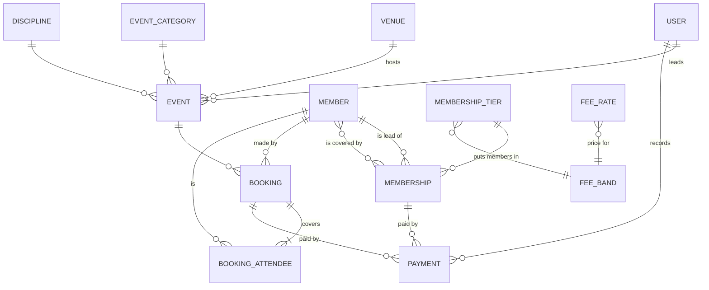
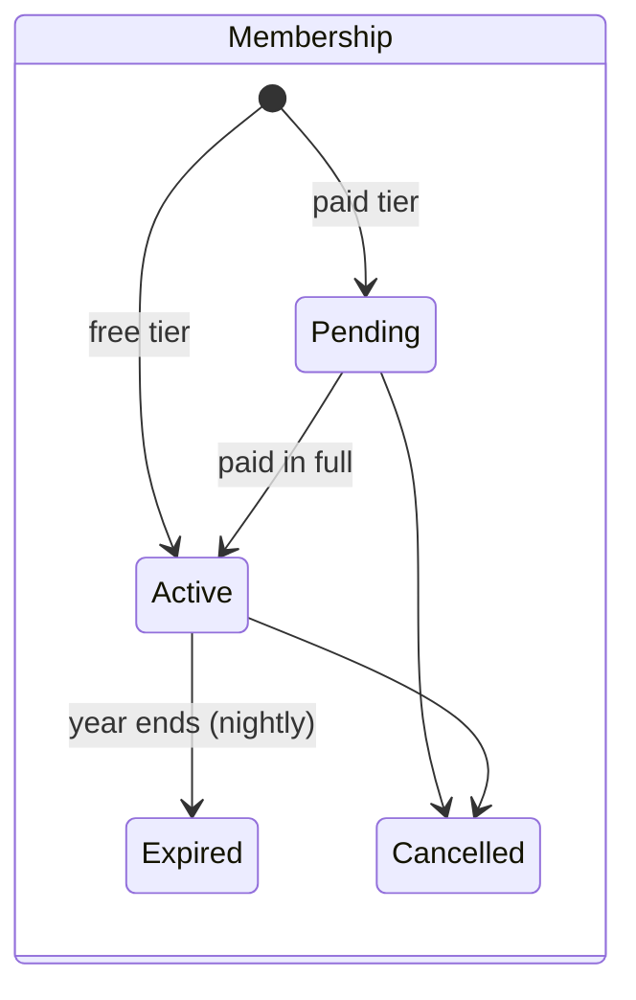
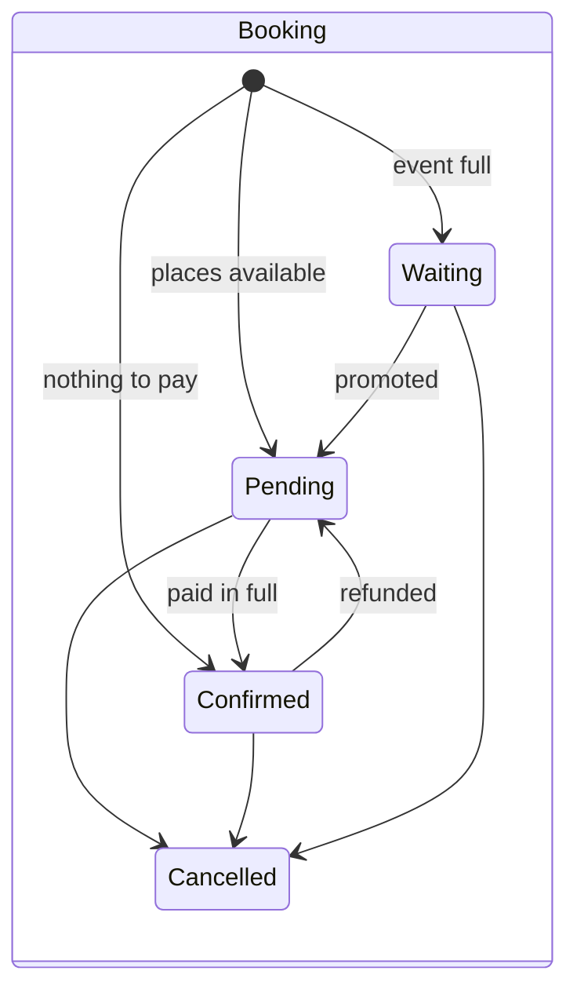

# Admin: members, events, bookings and payments

> The code is the spec. This records intent, rules and the acceptance criteria
> the tests were written from. Features F-30 to F-42 are built; where this
> disagrees with the code and `tests/`, the code wins.

## Purpose

Give the club's volunteers one place to run the club day to day: who is a
member, what is on, who is coming, who has paid, who to chase.

It does not take money. Payments are made by bank transfer, cash or PayPal
outside the system and **recorded** here (Phase 4 adds a gateway). Members can
log in and sign up (F-50, [members.md](members.md)), but can't book online
yet: staff enter bookings that arrive by email.

The admin is built for a desktop, but the register and "record payment" work
on a phone, because they are used at the waterside.

## Glossary

| Term       | Meaning                                                                                                                               |
| ---------- | ------------------------------------------------------------------------------------------------------------------------------------- |
| Member     | A person the club knows: a paying member, someone covered by a family membership, or a non-member who has been booked onto something. |
| Membership | One year on a tier for a lead member, optionally covering other people (family).                                                      |
| Tier       | A kind of membership with a price, e.g. "Adult: pay as you paddle".                                                                   |
| Fee band   | The price group a tier puts you in for sessions and events: non-member, pay as you paddle, subscriber or affiliate.                   |
| Fee type   | What kind of charge an event makes: session, half day, full day, competition, custom or free.                                         |
| Event      | Anything in the calendar: a session, trip, course, social or meeting.                                                                 |
| Series     | Weekly events created together, sharing a series id.                                                                                  |
| Booking    | One person's request for places on an event, covering one or more attendees and paid for as a whole.                                  |
| Attendee   | One person on a booking, with the price they were charged.                                                                            |
| Payment    | Money received for a booking or a membership. A negative payment is a refund.                                                         |
| To chase   | A booking or membership with money owed.                                                                                              |
| Register   | The list of people coming to an event, for the leader.                                                                                |

## Data model

Notes:

- `User` is a login with a role. `Member` is a person. A member's own login
  links to their record through `users.member_id` (F-50). Staff logins may
  have no member record.
- What is owed is worked out, never stored: a booking's total is the sum of
  its attendees' prices; a membership's is its price. Paid is the sum of
  payments. The status is kept in step by `refreshStatus()`.
- An attendee's price is fixed when the booking is made. Changing the fee
  table later does not change existing bookings.
- A booker or attendee need not be a `Member`: guests have just a name.

Deliberately left out for now: extra costs such as accommodation (F-48),
monthly subscription instalments (F-43), a log of who viewed medical data (F-47).

## States

Pending and confirmed bookings hold a place. Paying on arrival is allowed, so
a pending booking is a real booking. Cancelling an **event** keeps its
bookings, so refunds can be recorded against them.

## Roles

| Role                   | Members | Medical         | Memberships | Events | Bookings | Payments | Website | Inbox | Settings |
| ---------------------- | ------- | --------------- | ----------- | ------ | -------- | -------- | ------- | ----- | -------- |
| Administrator          | ✓       | ✓               | ✓           | ✓      | ✓        | ✓        | ✓       | ✓     | ✓        |
| Membership secretary   | ✓       |                 | ✓           |        |          | ✓        |         | ✓     |          |
| Programme and events   | ✓       |                 |             | ✓      | ✓        | ✓        |         | ✓     |          |
| Treasurer              | ✓       |                 | ✓           |        | ✓        | ✓        |         |       |          |
| Welfare officer        | ✓       | ✓               |             |        | ✓        |          |         |       |          |
| Session or trip leader |         | own events only |             | ✓      | ✓        |          |         |       |          |
| Website editor         |         |                 |             |        |          |          | ✓       | ✓     |          |
| Member                 |         |                 |             |        |          |          |         |       |          |

The table is `UserRole::areas()`. The Member role (F-50) has no areas: members
see only their own My membership page. See [members.md](members.md).

## Features

### F-30 Staff logins and roles

Staff sign in at `/admin/login`. Logins are created by an administrator
(Settings > Staff logins) or with `php artisan bvcc:staff`.

Acceptance criteria:

- It sends visitors who are not logged in to the admin login.
- It refuses a login that has no staff role.
- It shows every admin page to an administrator.
- It limits each role to its own areas, by address as well as in the menu.
- Member sign-up is a separate thing: see [members.md](members.md).

### F-31 Members

Club > Members. Search by name or email. Filter by tier, expiring soon, no
current membership, awaiting payment, and under or over 18. Each member's
memberships are on their record. Export the filtered list as CSV.

Acceptance criteria:

- It stores emergency and medical details encrypted and keeps them out of JSON.
- It shows medical details on a member only to welfare staff and administrators.
- It keeps medical details when someone who cannot see them saves the member.
- It includes emergency and medical columns in the CSV for welfare staff only.

### F-32 Memberships

Added from the member's record. Club > Memberships lists them all with
"record payment", "send reminder", "renew", "refund" and "cancel", and a
bulk "send reminders".

Acceptance criteria:

- It starts a paid tier as awaiting payment, for one year.
- It starts a free tier as active straight away.
- It becomes active once the balance is paid, not before.
- It covers every person on a family membership.
- It renews for the following year on the same tier for the same people.
- It starts a renewal today when the old membership has lapsed.
- It marks memberships as expired once their year has ended (nightly).
- It finds memberships expiring in the next 30 days.
- It emails the lead member a reminder and records when.
- It does not try to email a member with no address.

### F-33 Events and weekly series

Programme > Events. Create, edit, duplicate (to a new date, as a draft) and
cancel. "Create weekly series" plans a season in one step.

Acceptance criteria:

- It creates one event a week between two dates on the chosen weekday.
- It gives every event in a series its own address and the same series id.
- It hides drafts from the public site.
- It tells everyone booked or waiting when an event is cancelled, and keeps their bookings.
- It keeps a cancelled event visible on the site, marked as cancelled.

### F-34 Bookings, capacity and waiting list

On an event's Bookings tab, or Programme > Bookings for all events.

Acceptance criteria:

- It prices each attendee from their own membership band.
- It takes the booker's contact details from their member record.
- It confirms a booking once it is paid in full.
- It confirms a booking with nothing to pay straight away.
- It charges nothing when the fee is waived, and records why.
- It puts a booking on the waiting list when the event is full.
- It waits as a whole when there is not room for everyone on the booking.
- It frees the places when a booking is cancelled and lets a waiting booking be promoted.
- It refuses bookings on a cancelled event.
- It lists unpaid bookings to chase, but not for cancelled events.
- It emails a payment reminder and records when.

### F-35 Payments and refunds

Recorded against a booking or membership, with amount, method, date,
reference and who recorded it. Club > Payments is the read-only ledger for
the treasurer, with filters, a total and CSV export.

Acceptance criteria:

- It records a payment against a booking from the bookings list.
- It offers the amount still owed when recording a payment.
- It goes back to awaiting payment after a refund.
- It hides the payment action from roles that do not handle money.

### F-36 Fees by membership band

`FeeCalculator`, using Settings > Club fees. The public fee table on `/join`
and the price on every event page read the same data.

Acceptance criteria:

- It charges the published club fee for each band and event type.
- It uses the event's own prices when the fee type is custom.
- It treats someone with no current membership as a non-member.
- It takes a member's band from their active membership.

### F-37 Event register

The "Register" button on an event. Attendees with a paid tick, a "here"
switch, and a print layout and CSV.

Acceptance criteria:

- It shows medical details on a register to the event's leader but not to other leaders.
- It lets the register tick someone as attended.

### F-38 Dashboard

Acceptance criteria:

- It shows the headline numbers: current members by band, memberships
  expiring in 30 days, money outstanding, and how full the next event is.
- It lists unpaid bookings for upcoming events, soonest first.
- It lists unpaid, soon-to-expire and recently lapsed memberships.
- It shows only the parts a role is allowed to see.

### F-39 Programme calendar

Programme > Calendar: a month grid, or the year as twelve lists. Colour by
category; drafts and cancelled events in grey; booked and capacity on each.
An agenda list replaces the grid on a phone.

### F-40 to F-42 Website, inbox, settings

Ordinary create, edit and delete screens. Tiers and categories that are in
use cannot be deleted. You cannot delete your own login.

## Data protection

- Emergency contacts and medical notes are encrypted in the database with the
  app key, hidden from JSON, and left out of every public page by construction.
- They are shown to administrators and welfare officers, and to an event's
  leader on that event's register only.
- CSV exports stop spreadsheet formula injection.
- Still to decide: retention period, consent wording, and a log of access (F-47).

## Open questions

- Should a booking be cancelled automatically if unpaid by the cut-off?
- Should promoting from the waiting list be automatic when a place frees up (F-56)?
- Should leaders be limited to their own events (F-49)?
- Do volunteers need a fee waiver recorded per event, or a standing one?
