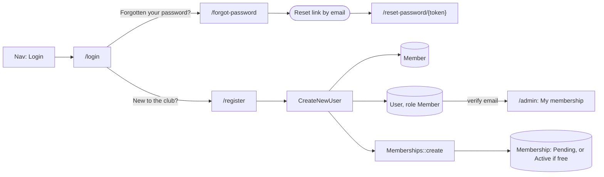

# Members: accounts, sign-up and self-service

> The code is the spec. This doc records why member accounts work the way they
> do, the acceptance criteria the tests were written from, and a log of later
> changes. Where it disagrees with the code and `tests/`, the code wins. Fix
> the doc in the same change.

Covers F-50 (member accounts) and the start of F-51 (join online). The rest of
Phase 3 (F-51 to F-58) builds on this.

## Purpose

The old site let members log in (Theme My Login and Paid Memberships Pro) to
join, renew and book. The new site brings that back in steps. The first step
gives members a login, lets new people sign up and choose a membership type,
and covers forgotten passwords. Paying and booking online come later.

## How it works

- **Login** is the last item in the main nav, in the header and in the phone
  menu. A logged-in user sees **My account** instead, which goes to `/admin`.
- `/login`, `/register`, `/forgot-password` and `/reset-password/{token}` are
  Fortify routes. `FortifyServiceProvider` renders them as site pages
  (`resources/js/pages/site/account/*`) in the site layout, each with a
  `noindex` `Seo`.
- **Sign-up** (`App\Actions\Fortify\CreateNewUser`) does three things in one
  transaction:
    1. creates a `Member` from the form (details, address, Paddle UK number,
       experience, emergency contact, medical notes, photo consent)
    2. starts a membership on the chosen tier through `Memberships::create()`:
       Pending on a paid tier, Active on a free one
    3. creates a `User` with the `Member` role, linked by `users.member_id`
- The new member gets a verification email. The admin panel needs a verified
  email (`->emailVerification()`). Staff logins made by an administrator, by
  `bvcc:staff` or by the demo seeder are marked verified when they are created.
- **In the admin**, the `Member` role has no areas, so every staff resource,
  page and widget is hidden from members and refused by address. Members see
  the **My membership** page (`App\Filament\Pages\MyMembership`) and a summary
  widget on the dashboard (`MyMembershipSummary`). Both are read-only.
- **Settings > Staff logins** lists staff only. Members are managed as
  members, under Club > Members.
- Old addresses: `/lostpassword`, `/resetpass`, `/my-account`,
  `/membership-account/*` and `/membership/membership-checkout` redirect to
  their new equivalents (`ClubSeeder::redirects()`). `/login` and
  `/register` are the same paths as before.

## Decisions

| Decision                                                                                    | Why                                                                                                                                                                            |
| ------------------------------------------------------------------------------------------- | ------------------------------------------------------------------------------------------------------------------------------------------------------------------------------ |
| The nav says **Login**, and the login page offers Register.                                 | One clear link. People without an account find Register right beside the login form.                                                                                           |
| Members use the Filament admin, with a `Member` role that has no areas.                     | One login place for everyone, and the existing role-to-area gating keeps staff data hidden without new code. We add member pages to the admin as F-51 to F-58 are built.       |
| Sign-up creates a membership through `Memberships::create()`: pending unless it's free.     | Club rules stay in `app/Services`. Staff see new paid sign-ups in "Memberships to chase" and record the payment the way they do now.                                           |
| `users.member_id` links a login to a member (nullable, unique).                             | Staff logins don't need a member record. A member has at most one login.                                                                                                       |
| Sign-up always creates a **new** member record. It never links to an existing one by email. | Linking by email before the address is proved would let someone claim, or overwrite, another person's record. Staff merge duplicates for now (see open questions).             |
| Emergency contact name and phone are required at sign-up.                                   | The club needs a contact for everyone on the water. Relationship is optional.                                                                                                  |
| Login, sign-up and password pages use the site layout.                                      | They're public pages reached from the site nav, so they should look like the site. Email verification, two-factor and password confirmation keep the starter kit look for now. |
| A verified email is needed to get into the admin.                                           | Anyone can sign up, so the address has to be proved before the account is used.                                                                                                |

## Acceptance criteria

Tests: `tests/Feature/Auth/MemberAccountsTest.php`.

- It shows the login page in the site layout, linking to register and to
  forgotten password.
- It shows the register page with the membership tiers on sale.
- It creates a member, their login and a pending membership on a paid tier,
  and sends a verification email.
- It makes a free membership active straight away.
- It stores emergency contacts and medical notes encrypted.
- It checks the sign-up form: the email must not already have a login, the
  tier must be on sale, the required fields must be filled, the date of birth
  must be in the past, and the passwords must match.
- It holds a member at email verification before the admin.
- It lets a member see their dashboard and their membership.
- It keeps members out of the staff pages.
- It shows members only their own widget.
- It leaves member logins out of the staff logins list.
- It emails a member a link to reset a forgotten password.
- It sends the old site's account addresses to the new ones.

These are checked by hand (they're front-end only):

- The nav shows Login, or My account once logged in, on a phone and on a
  desktop.
- Each form works at 360px wide, with tap targets of at least 44px.

## Build steps (F-50)

- [x] Branch `f-50-member-accounts`. Record the plan here.
- [x] Tests first: `MemberAccountsTest.php`.
- [x] `users.member_id`, plus the `User::member()` and `Member::user()` relations.
- [x] `UserRole::Member` with no areas. `UserRole::staff()` and `isStaff()`.
      Staff logins and `bvcc:staff` offer staff roles only.
- [x] Fortify registration on. `CreateNewUser` creates the member, membership
      and login.
- [x] Site-styled Login, Register, ForgotPassword and ResetPassword pages.
      Login / My account in the nav.
- [x] My membership page and summary widget. `ClubStats` is staff only. The
      admin needs a verified email.
- [x] Old account addresses redirect. Demo login `member@bvcc.test`.
- [x] Docs: this file, spec.md, admin.md, CLAUDE.md and README.
- [x] `composer test` passes for F-50: Pint, Larastan and every test in
      `MemberAccountsTest.php`. Local mail goes to Mailpit (see README).
- [ ] `npm run build:ssr` and the by-hand checks above, with Mailpit
      running.

## Next (left to build)

- Let members edit their own details and emergency contacts (needs a rule on
  which fields they may change).
- Payment instructions on My membership, then online payment (F-51, Phase 4).
- Renew online (F-51). See and cancel bookings (F-52, F-53).
- Add family members on a household tier (F-54). Sign-up covers only the
  person signing up for now.
- Restyle the verify-email, two-factor and confirm-password pages in the site
  look.
- Import existing members' accounts (F-57).

## Open questions

- **Existing members signing up.** Someone already in the system who registers
  gets a second member record. Do we link to the existing record after the
  email is verified, or do staff merge them by hand?
- **Committee approval.** Should a new sign-up be approved before the
  membership counts, or is payment enough?
- **Under-18s.** Should a parent or guardian sign up for them, and should we
  collect their details or consent?
- **What members may change** themselves (address, phone, emergency contact,
  medical notes) and what only staff may change.

## Change log

- **2026-10-28.** F-50 basics built, as planned above. One change from the
  plan: no auto-linking to an existing member by email (see Decisions).
  Fixed along the way: `email_verified_at` isn't fillable, so staff logins
  were created unverified. That didn't matter until the admin required
  verified email.
- **2026-10-28.** Local email goes to Mailpit (`MAIL_MAILER=smtp`, port 1025),
  which `composer dev` starts when it is installed, so the verification and
  reset emails can be followed end to end.
