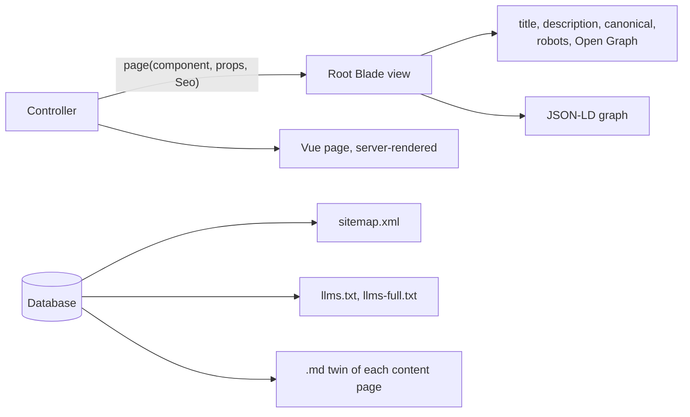

# Being found: SEO and AEO

How the site is made easy to find and easy to quote, by search engines (SEO)
and by AI assistants and answer engines (AEO). Built in F-04 and F-22; covered
by `tests/Feature/Site/SeoTest.php`.

## How it works

- **The content is in the HTML.** Public pages are rendered on the server by
  Inertia SSR, so a crawler that runs no JavaScript still gets the text.
- **Meta tags and structured data do not depend on SSR.** They are printed by
  `resources/views/app.blade.php` from an `App\Support\Seo` object that every
  public controller must supply.
- **Nothing is written twice.** The sitemap, llms.txt, the fee table and the
  structured data are all built from the database, so they cannot go stale.

## Rules for every public page

1. Give it a `Seo` with a specific title (what it is, and where if it helps)
   and a description of 120 to 160 characters that answers "what is this?".
2. One `h1`. Headings in order.
3. Pass breadcrumbs; they become the visible trail and `BreadcrumbList`.
4. Add the schema.org node that fits (table below).
5. Lists that are filtered or paged, and anything stale, set `index: false`.
6. Describe every photo (alt text) in the admin.

## Writing for answer engines

People ask assistants questions; pages that answer in the same shape get quoted.

- **Answer first.** Start a page with the "quick facts" block: when, where,
  cost, who it suits. Start an FAQ answer with the answer.
- **Headings as questions**: "How do I start whitewater kayaking?".
- **One fact, one place, real numbers.** Prices and times come from the
  database, so every page and feed agrees.
- **Show it is current**: "Last reviewed" dates on pages; keep them true.
- **Plain words.** Say "club fee", "pay as you paddle" the same way everywhere.

The admin's field hints say the same, so editors do it without reading this.

## Structured data

One JSON-LD graph per page. The club and website nodes are on every page and
other nodes point at them by `@id`.

| Page                                            | Nodes                                                                                                                                          |
| ----------------------------------------------- | ---------------------------------------------------------------------------------------------------------------------------------------------- |
| Every page                                      | `SportsClub` + `SportsOrganization` (name, logo, founding date, sports, area served, home address, governing body, social profiles), `WebSite` |
| Below the home page                             | `BreadcrumbList`                                                                                                                               |
| Home, Join, Events, FAQs, hire, pages with FAQs | `FAQPage`                                                                                                                                      |
| Event                                           | `SportsEvent`: dates, status (scheduled or cancelled), `Place`, capacity, one `Offer` per fee band in GBP                                      |
| Events list                                     | The next ten events                                                                                                                            |
| Venue, venues list                              | `Place` with address, and coordinates once a map pin is set (F-46)                                                                             |
| News post                                       | `NewsArticle`                                                                                                                                  |

## For crawlers

| Address                | What                                                                                                                                                                                     |
| ---------------------- | ---------------------------------------------------------------------------------------------------------------------------------------------------------------------------------------- |
| `/robots.txt`          | Allows everything but `/admin` and `/img/`, and names the sitemap. On any environment but production it disallows everything.                                                            |
| `/sitemap.xml`         | Pages, disciplines, venues, news, and events that are upcoming or under a month old. No drafts, logins or admin.                                                                         |
| `/llms.txt`            | A short Markdown guide to the club and the site (llmstxt.org layout): key facts, tiers and prices, disciplines, venues, upcoming events.                                                 |
| `/llms-full.txt`       | The main pages, FAQs and upcoming events in one Markdown file.                                                                                                                           |
| `/{page}.md`           | A Markdown twin of every content page, discipline, event and news post, announced with `<link rel="alternate" type="text/markdown">`, with a canonical header pointing at the HTML page. |
| `/news/feed.xml`       | RSS                                                                                                                                                                                      |
| `/events/calendar.ics` | iCalendar feed of events                                                                                                                                                                 |

AI crawlers are welcome: `robots.txt` has no blocks for them. That is a
choice; a club wants to be the answer when someone asks an assistant "where
can I learn to kayak near Aldershot?".

## Old addresses

Every address the WordPress site served gets a 301 to its new home, so
existing search rankings and links carry over. See F-21 in spec.md.

## Speed

- Photos are resized to the screen and served as WebP (`/img/{width}/…`),
  with `width`, `height` and lazy loading. The hero photo is fetched first.
- Fonts are self-hosted and preloaded. No third-party scripts.
- Pages ship only the JavaScript for that page.

## Checklist

- [x] Server-rendered content, one `h1`, ordered headings
- [x] Title, description, canonical, Open Graph and Twitter card on every page
- [x] `SportsClub`, `SportsEvent`, `FAQPage`, `BreadcrumbList`, `Place`, `NewsArticle`
- [x] Sitemap, robots, llms.txt, llms-full.txt, Markdown twins, RSS, iCal
- [x] 301 redirects from the old site
- [x] Non-production copies are `noindex`
- [ ] Lighthouse mobile run against a production-like build (not yet run)
- [ ] Validate live pages in Google's Rich Results Test after go-live
- [ ] Register in Google Search Console and Bing Webmaster Tools; submit the sitemap
- [ ] A Google Business Profile for the club, with the same name, address and hours
- [ ] Map pins for venues (F-46)
- [ ] Alt text on the 40 imported photos
- [ ] Analytics that respects privacy (F-44)
